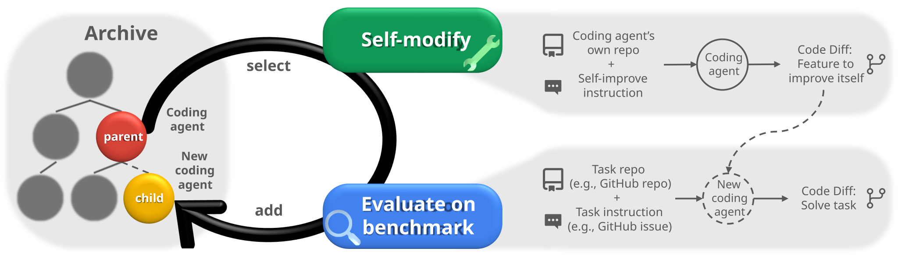

<h1 align="center">
    达尔文哥德尔机器（Darwin Gödel Machine）：<br/>自改进智能体的开放式进化
</h1>

<p align="center">
  <a href="https://github.com/jennyzzt/dgm/blob/main/LICENSE"></a>
  <a href="https://arxiv.org/abs/2505.22954"></a>
  <a href="https://sakana.ai/dgm/"></a>
  <a href="https://x.com/SakanaAILabs/status/1928272612431646943"></a>
  <a href="https://drive.google.com/drive/folders/1Kcu9TbIa9Z50pJ7S6hH9omzzD1pxIYZC?usp=sharing"></a>
</p>


本仓库实现了 **达尔文哥德尔机器（Darwin Gödel Machine，DGM）**：一种自改进系统，通过反复修改自身代码，逐步改善编程能力（包括修改自身代码的能力），并使用编程基准对每次改动进行实证验证。

中文学习入口：[DGM 自进化源码导读](docs/DGM自进化源码导读.md)。核心源码已补充中文注释，解释父代选择、失败诊断、补丁继承、工具调用、评估与归档；实际发送给模型的英文提示词保留原文。

<p align="center">
  
</p>
<!-- <p align="center">
</a><br>
</p> -->


## 环境配置

以下保留原项目的 Linux/Bash 命令。源码与容器脚本使用 `/bin/bash`、`cp`、`patch` 和 `timeout` 等 Linux 工具；Windows 用户应在配好 Docker 的 Linux 环境（例如 WSL）中运行，而不是直接把这些命令粘贴到 PowerShell。

```bash
# 使用项目配置文件；已有 .env 时直接编辑其中的 DeepSeek 配置
cp .env.example .env
# 填写 DEEPSEEK_API_KEY，默认模型为 deepseek-v4-flash
```

项目会自动加载根目录下的 `.env`，已有环境变量优先；VS Code 调试配置也会读取它。`.env` 已被 Git 和 Docker 构建忽略，请勿提交真实密钥。编程代理、失败诊断、改进诊断和辅助评分统一使用 `DEEPSEEK_MODEL`，不需要 OpenAI 或 AWS 凭据。`DEEPSEEK_BASE_URL` 默认为 `https://api.deepseek.com`，`DEEPSEEK_THINKING` 控制思考模式（`enabled` 或 `disabled`），`DEEPSEEK_MAX_TOKENS` 控制输出上限（默认 8192）。容器中的代理通过环境变量接收同一份配置。

```bash
# 验证当前环境中的 Docker 是否配置正确
docker run hello-world
 
# 如果出现权限错误，将当前用户加入 Docker 用户组
sudo usermod -aG docker $USER
newgrp docker
```

```bash
# 创建虚拟环境并安装依赖
python3 -m venv venv
source venv/bin/activate
pip install -r requirements.txt

# 可选：安装绘图和分析所需依赖
sudo apt-get install graphviz graphviz-dev
pip install -r requirements_dev.txt
```

```bash
# 克隆 SWE-bench，并切换到原项目指定的提交
cd swe_bench
git clone https://github.com/princeton-nlp/SWE-bench.git
cd SWE-bench
git checkout dc4c087c2b9e4cefebf2e3d201d27e36
pip install -e .
cd ../../

# 准备 Polyglot 数据集
# 请事先为 Git 配置用户名和邮箱
python -m polyglot.prepare_polyglot_dataset
```

默认通过 DeepSeek Chat Completions 调用原生工具，并在后续工具请求中回传 `reasoning_content`。模型和客户端配置见 [`llm.py`](llm.py)，编程工具循环见 [`llm_withtools.py`](llm_withtools.py)。修改源码后，应重新构建已有的 DGM 镜像：`docker build -t dgm .`。

## 运行 DGM
```bash
python DGM_outer.py
```
默认情况下，输出保存在 `output_dgm/` 目录下，每次实验使用独立的时间戳子目录。配置和运行前可先阅读[源码导读中的实现注意点](docs/DGM自进化源码导读.md#当前实现中需要留意的地方)。

## 文件结构

- `analysis/`：绘图和实验分析脚本。
- `initial/`：初始代理在 SWE-bench 上的日志与性能结果。
- `initial_polyglot/`：初始代理在 Polyglot 上的日志与性能结果。
- `swe_bench/`：SWE-bench 解题与评估代码。
- `polyglot/`：Polyglot 多语言编程基准的数据准备、解题与评估代码。
- `prompts/`：发送给基础模型的提示词。
- `tests/`：DGM 系统的测试。
- `tools/`：基础模型可以调用的工具。
- `utils/`：补丁谱系、评估汇总、Git 操作与容器管理等辅助函数。
- `coding_agent.py`：初始 SWE 编程代理的主要实现。
- `coding_agent_polyglot.py`：初始 Polyglot 编程代理的主要实现。
- `llm.py`：基础模型客户端与文本调用封装。
- `llm_withtools.py`：支持工具调用的代理对话循环。
- `self_improve_step.py`：一次自修改、补丁导出与基准评估的完整流程。
- `DGM_outer.py`：DGM 进化算法的运行入口。
- `docs/DGM自进化源码导读.md`：中文调用链、关键算法、输出文件和实现注意点。

## 实验日志

这个 [Google Drive 文件夹](https://drive.google.com/drive/folders/1Kcu9TbIa9Z50pJ7S6hH9omzzD1pxIYZC?usp=sharing)包含论文所述实验中基础模型的全部输出日志。

## 安全注意事项
> [!WARNING]  
> 本仓库会执行由模型生成、未经信任验证的代码。我们强烈建议用户了解相关安全风险。在当前设置和所用模型下，这些代码实施明显恶意行为的可能性很低，但仍可能由于模型能力或对齐方面的局限而产生破坏性行为。使用本仓库即表示您知悉并接受这些风险。

## 致谢

评估框架的实现基于 [SWE-bench](https://github.com/swe-bench/SWE-bench) 和 [polyglot-benchmark](https://github.com/Aider-AI/polyglot-benchmark) 仓库。

## 引用

如果本项目对您的研究有帮助，请考虑引用以下论文（保留原始 BibTeX，便于文献管理）：
```bibtex
@article{zhang2025darwin,
  title={Darwin Godel Machine: Open-Ended Evolution of Self-Improving Agents},
  author={Zhang, Jenny and Hu, Shengran and Lu, Cong and Lange, Robert and Clune, Jeff},
  journal={arXiv preprint arXiv:2505.22954},
  year={2025}
}
```
