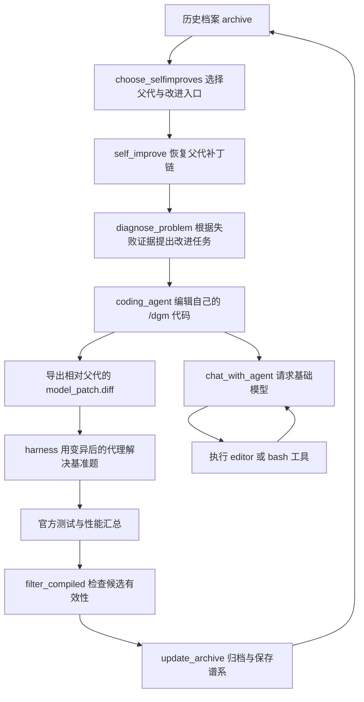

# DGM 自进化源码导读

本文依据本仓库当前源码编写，侧重实际调用关系。README 是原说明文档的中文翻译；本文补充学习路径和实现细节。源码中的中文注释不修改执行语句、模型提示词或工具 schema。

## 先理解“进化”的对象

DGM 修改的是编程代理的软件实现：工作流、提示词、文件编辑工具、命令工具和辅助函数。基础模型通过 API 提供推理与代码生成能力，本仓库的进化流程没有进行梯度更新或模型权重训练。

初始代理能使用工具编辑一个仓库。让它编辑普通题目仓库，就得到解题补丁；让它编辑存放自身实现的 `/dgm/`，就得到代理变异。宿主机再把变异后的代理放进基准环境解题，观察解题率，决定哪些版本可以进入档案、成为下一轮父代。

这里的“提升”是评估目标，不是每次变异的保证。默认会保留有效但分数下降的节点，允许从历史分支继续探索。

## 建议阅读顺序

| 顺序 | 文件 | 要回答的问题 |
| --- | --- | --- |
| 1 | [`DGM_outer.py`](../DGM_outer.py) | 如何选择父代、生成一代候选、更新档案？ |
| 2 | [`self_improve_step.py`](../self_improve_step.py) | 一次自修改如何从失败日志走到新代理的评估结果？ |
| 3 | [`prompts/self_improvement_prompt.py`](../prompts/self_improvement_prompt.py) | 如何把具体失败解释为通用能力改进？ |
| 4 | [`coding_agent.py`](../coding_agent.py) | 初始代理如何接受任务并编辑代码？ |
| 5 | [`llm_withtools.py`](../llm_withtools.py) | 模型工具请求如何变成真实动作并形成循环？ |
| 6 | [`tools/__init__.py`](../tools/__init__.py)、[`tools/edit.py`](../tools/edit.py)、[`tools/bash.py`](../tools/bash.py) | 新工具如何注册，编辑和测试如何执行？ |
| 7 | [`utils/evo_utils.py`](../utils/evo_utils.py)、[`utils/git_utils.py`](../utils/git_utils.py) | 如何恢复祖先代码、生成增量 diff、计算分数？ |
| 8 | [`swe_bench/harness.py`](../swe_bench/harness.py)、[`swe_bench/report.py`](../swe_bench/report.py) | 如何区分代理解题和官方测试验收？ |
| 9 | [`coding_agent_polyglot.py`](../coding_agent_polyglot.py)、[`polyglot/harness.py`](../polyglot/harness.py) | 多语言路线与 SWE 路线有什么区别？ |

[`llm.py`](../llm.py) 管理基础模型调用，[`utils/docker_utils.py`](../utils/docker_utils.py) 管理自修改容器；可以在理解主线后阅读。

## 两层循环的调用关系



外层每一代可并行执行多次 `self_improve`。内层 `chat_with_agent` 则在一次编辑任务中反复执行工具请求，直到模型停止请求工具或发生异常。两种循环的终止条件、任务粒度和日志都不同。

## 一次变异具体如何发生

1. **选择父代与改进入口。** 从 `archive` 读取各节点的 `metadata.json`。入口通常是父代没有解决的题目，也可以是空补丁、随机性或上下文溢出等通用问题。
2. **恢复父代。** `get_model_patch_paths` 沿 `parent_commit` 追溯祖先，将补丁列表反转为从早到晚的顺序。自修改容器从初始代码开始，逐个应用这些补丁。
3. **建立 Git 基线。** 将恢复后的代理提交到容器内 Git 仓库。后续导出的是相对这个父代基线的增量，而不是整个历史补丁。
4. **生成改进任务。** `diagnose_problem` 用诊断模型读取失败日志、测试结果与代理实现，输出包含 `implementation_suggestion` 和 `problem_description` 等字段的 JSON，再把这些字段组成可实施任务。
5. **让父代修改自己。** 调用 `/dgm/coding_agent.py --git_dir /dgm/ --self_improve`，给它刚才的改进任务。工具直接改写容器文件；进程结束时用 Git 导出 `model_patch.diff`。
6. **在新的题目环境评估子代。** 把祖先补丁与本次补丁一起交给基准 harness，重建子代代理。它编辑的是 `/testbed/` 中的题目仓库。最终得分来自题目测试，而不是诊断模型声称“改进成功”。
7. **归档。** 保存补丁、日志、任务与性能。外层先检查候选结果是否有效，再按归档策略加入历史档案，供下一代选择。

新代码在后续进程/容器中被执行；并不是运行中的 Python 对象自动热更新。进化节点通常用时间戳命名，`parent_commit` 也是节点 ID；传给 `git diff` 的 `base_commit` 才是真正的 Git 提交哈希。

## 父代选择与开放式探索

默认选择策略是 `score_child_prop`。对节点 i，令 s_i 为解题率，c_i 为它已有的直接子代数：

```text
quality_i = 1 / (1 + exp(-10 * (s_i - 0.5)))
weight_i = quality_i / (1 + c_i)
probability_i = weight_i / sum(weight_j)
```

高分提高抽样机会，子代较多降低再次选择的权重。抽样使用 `random.choices`，允许重复父代；同一父代可在一代内产生不同变异。

默认 `keep_all` 保留通过有效性检查的所有新节点，不要求超过父代。历史分支提供更多探索起点。`keep_better` 的实际门槛是“初始代理分数减去 `eval_noise`”，并不是与各自父代比较。

`no_darwin` 只选最后一个候选父代，以便对照历史分支搜索的作用。`no_selfimprove` 在自修改容器中跳过祖先补丁；当前代码后续仍把已有补丁链传到评估路径，理解该消融时应逐段看实际执行逻辑。

SWE 的改进方向按顺序尝试随机判断：空补丁条件、随机性、上下文溢出，最后才选择失败题。前一分支命中后会 `continue`，因此各方向的最终概率不是简单相加的三个 25%。Polyglot 优先选择空补丁和失败题，再在诊断模板中选择随机性或普通问题分析。

## 诊断提示词与学习方式

`prompts/self_improvement_prompt.py` 要求诊断模型提出 **一个** 详细改进方案，强调工具和能力应适用于多个题目或仓库。JSON 中的字段分工如下：

| 字段 | 中文含义 |
| --- | --- |
| `log_summarization` | 总结解题轨迹、工具使用和遇到的问题 |
| `potential_improvements` | 列出可能改善代理能力的方向 |
| `improvement_proposal` | 选出一个高影响的改进方案 |
| `implementation_suggestion` | 结合代理结构给出具体实施建议 |
| `problem_description` | 把方案写成可交给编程代理实施的问题描述 |

特殊模板未必包含 `log_summarization`。拼接自修改任务时，代理架构说明与后两个字段是主要输入。

诊断阶段会利用已有官方测试证据；提示词同时声明，解题评估时代理看不到这些私有测试。`get_current_code` 实际拼接“基础源码与补丁文本”，没有先在宿主机应用补丁。执行父代代码则需要容器中的真实补丁重放。

运行时英文提示词保留原文，避免翻译改变模型行为。中文注释、字段表和本文用于阅读；不能把任意英文字段改成中文，因为它们同时是程序解析契约。

## 工具循环如何修改现实文件

`tools.load_all_tools()` 扫描 `tools/` 下的 Python 模块，每个工具必须提供：

- `tool_info()`：模型可见的名称、描述和 `input_schema`。
- `tool_function()`：接收 schema 对应的参数，执行动作并返回字符串。

模型先给出工具名和参数，`process_tool_call` 再调用真实函数。`editor` 可以查看文件、创建文件、覆盖整个文件；`bash` 可以执行命令和测试。执行结果回传给模型后，它再决定下一步动作。

Claude 使用 `tool_use_id` 关联调用与结果，o3 使用 `call_id`。没有原生工具调用的模型则通过 `<tool_use>` 文本标签表达动作。新工具只要满足注册接口，下次加载时即可被发现，这为代理扩展自身能力提供了实现入口。

初始 `coding_agent.forward()` 并没有自动调用所有测试辅助函数，只是构造提示并进入工具循环。回归测试、报告评分、同分候选比较等函数是已有辅助能力，应区分“源码中存在”与“当前执行路径实际使用”。

## 两种补丁与两种评分

| 项目 | 修改对象/含义 | 产生或消费位置 |
| --- | --- | --- |
| 代理进化补丁 | `/dgm/` 中代理实现的增量 | `self_improve_step.py` 保存到节点目录 |
| 基准题解题补丁 | `/testbed/` 中题目仓库的修改 | harness 写入逐题预测 JSON 的 `model_patch` |
| `accuracy_score` | 已解决题目实例数 / 已提交题目实例数 | `utils/evo_utils.get_all_performance` |
| `get_report_score` | 一份代理内部测试报告中的测试通过比例 | `utils/eval_utils.py` |
| 事后诊断 `score` | 模型对改进影响给出的 -2 到 2 的解释性评分 | `prompts/diagnose_improvement_prompt.py` |

三种分数不可混用。父代抽样使用 `accuracy_score`。重复评估时，统计按提交实例累加，题目 ID 可能重复；总体解题率不是各份报告分数的简单平均。

SWE 分成“harness 生成解题预测”和“make_report 调用官方评估器”两步。导出官方输入前，会按路径模式去掉解题补丁里的测试修改。Polyglot 则在 harness 内保留 solution 文件修改，恢复官方测试提交，再依据语言运行测试脚本。

## 输出文件怎么读

```text
output_dgm/<实验ID>/
├── dgm_outer.log             外层选择、归档和错误信息
├── dgm_metadata.jsonl        每代档案快照（每条记录实际跨多行）
├── initial/                 初始代理的缓存性能和轨迹
└── <子代节点ID>/
    ├── metadata.json        父节点、改进入口、任务、评估性能
    ├── model_patch.diff     本次代理变异的增量补丁
    ├── self_evo.md          代理修改自身代码的对话轨迹
    ├── self_improve.log     容器操作和评估过程日志
    ├── predictions/         各基准题的对话、解题补丁与测试材料
    └── *.json               基准评估汇总报告（若该阶段成功）
```

学习某个节点时，先读 `metadata.json` 确认父代和改进任务，再读 `model_patch.diff` 看具体改动，然后比较父子 `accuracy_score` 和逐题日志。沿 `parent_commit` 回溯可重建这条分支的变异历史。文件存在不等于评估成功，异常路径可能只留下部分结果。

`initial/` 和 `initial_polyglot/` 中的大量 Markdown 是原始实验轨迹，不属于项目使用说明。这次保留它们的原始内容，也保留许可证、参考答案、数据与协议文字，以便对照真实运行证据。

## 当前实现中需要留意的地方

以下是静态阅读源码确认的行为或接口问题，已在相应位置注明；本次注释与翻译没有修复算法或运行逻辑。

| 位置 | 实际行为及影响 |
| --- | --- |
| `DGM_outer.main` 的 `choices` | `score_child_prop` 与 `best` 之间缺少逗号，被拼接为一个字符串；显式传入这两个选项时可能被拒绝。默认值仍为 `score_child_prop`。 |
| `choose_selfimproves` 的 `best` 分支 | 升序排序后取前面的节点，实际取低分而不是高分。 |
| `choose_selfimproves` 的 `unresolved_ids == 0` | 列表与整数比较不能检测空列表，随后空列表抽样会报错。 |
| `get_full_eval_threshold` / `self_improve` | 外层传入完整评估阈值，但内层未使用；加载了 big 子集，也未据此执行完整评估。Polyglot 路径仍会经过 SWE 阈值计算。 |
| `is_compiled_self_improve` | 检查字段、非空解题补丁和最低提交数，不执行编译、不要求能力提升；只读取 `num_swe_issues[0]`，缺省空列表与 `logger=None` 不能安全支持所有路径。 |
| 可选事后诊断 | 日志函数已经返回四项，提示构造器仍按三项解包、传参；内层有效性检查也未提供必要参数，当前路径存在失败风险。 |
| `future.result(timeout=...)` | 在 `as_completed` 之后调用，不能提供任务运行时间的硬上限。 |
| `tools/bash.tool_function_call` | 每次新建 shell，`cd` 和环境变量不跨调用继承；与工具描述的持久状态需要区别理解，也未显式调用 `stop`。 |
| `llm_withtools` 的异常路径 | 多处捕获异常后 `pass`，可能只返回已有历史；应结合实际补丁和错误日志判断成功。 |
| `check_for_tool_use` 的 o3 分支 | 空输出或没有 function_call 时处理不完整，可能触发异常并被外层吞掉。 |
| 追加评估 | 触发条件按成功实例总数比较，重复评估会影响门槛；Polyglot 的深评结果另存，外层抽样仍读取浅评字段。 |
| `polyglot.harness` | 原地过滤并覆盖传入补丁；只支持一次评估；直接写报告但返回的目录列表为空。 |
| `swe_bench.report.run_evals` | `os.chdir` 改变整个进程工作目录，与线程并发运行存在相互影响。 |

这些区别帮助区分设计思路与当前实现。中文注释的验证采用 Python 语法解析、与原版本的 AST 对比及去除注释后的 token 对比；它们能确认执行语句和字符串未变，不能证明 Docker、API 或基准评估已经运行成功。源码注释也可能进入诊断时读取的源码上下文，增加输入长度，因此不保证模型输出与原仓库完全一致。
